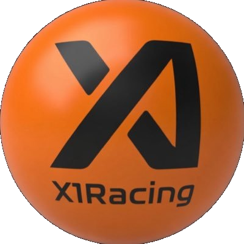
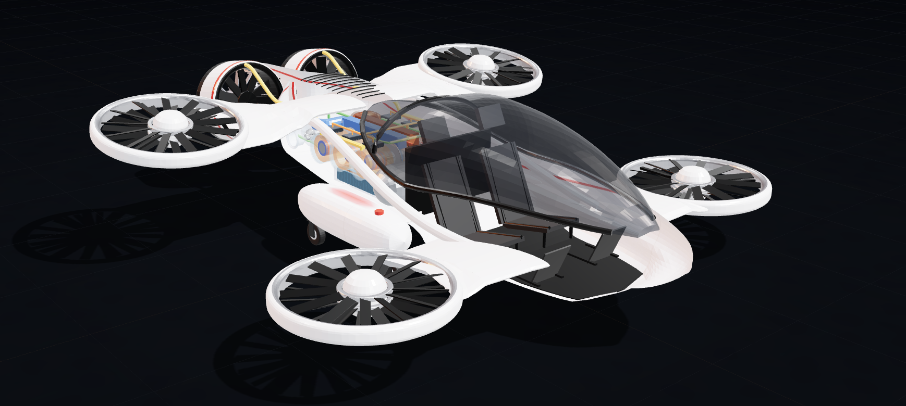

  

<h1 align="center">X1 SkyRacer</h1>

  <strong>Project MAXIMUM BOOST</strong> 
  Race. Iterate. Accelerate.

  <a href="https://buildflyingcars.com"><strong>buildflyingcars.com</strong></a> &nbsp;|&nbsp; <a href="https://x1racing.com"><strong>x1racing.com</strong></a>

  A project of <a href="https://x1racing.com">X1 Racing</a> &nbsp;|&nbsp; <a href="rule-book/X1_Racing_Rule_Book_v1.0.md"><strong>Read the rules</strong></a> &nbsp;|&nbsp; <a href="https://x1racing.com/game"><strong>Play the game</strong></a>

  <a href="https://buildflyingcars.com/x1-skyracer/viewer/"><strong>3D viewer</strong></a> &nbsp;|&nbsp; <a href="https://buildflyingcars.com/x1-skyracer/hauler/"><strong>Transport study</strong></a> &nbsp;|&nbsp; <a href="https://buildflyingcars.com/x1-racer"><strong>Design your own</strong></a>

  

---

## Maximum Boost

<h3 align="center">(Public funds × sponsors) + (open source × SI) + racing = break the certification barrier.</h3>

Flying cars aren't held back by physics, engineering or software. They're held back by certification. **Project MAXIMUM BOOST** breaks that barrier by racing.

The **X1 SkyRacer** is the car. It is a two-seat, side-by-side flying car, built to race and designed to carry 2 people. The 500 lb passenger payload is a design requirement: when raced, the car is remote-piloted and unmanned, and the seats carry 500 lb of ballast. Racing is the mechanism. Maximum Freedom is the prize: a flying car in every driveway.

Racing is the fastest, lowest-cost way to get flying cars flying a lot. Every race produces real flight data, and every season the cars get faster, safer and smarter. What we learn flows to the car makers, the freight industry, the power grid, and ultimately your garage.

**Racing is always unmanned.** Every X1 car is flown remotely by a pilot on a game controller, boosted by a mandatory onboard SI (Super Intelligence) layer, so nobody is aboard when cars push their limits. Then the same airframe, with the SI as co-pilot, carries people.

**Fold it. Haul it. Fly it.** SkyRacers fold to fit in a race-car hauler: roll it off, unfold it, fly it. Unfolded, it fits in a standard two-car garage.

## Maximum Industry: who races it, and who pays

These designs are intended to be raced by existing professional, vetted racing organizations. The X1 Cup is designed for up to 17 of the world's most established racing organizations, with up to 50 aircraft. They already have the sponsors, the sales channels and the championships to chase. Those teams are prospective. None have been named or committed yet.

The money moves through **X1 Racing as prime contractor**. It is a proposal, not funds in hand:

| Piece | Amount | What it is |
|---|---|---|
| Upfront federal investment | **$2.2 billion** | The catalytic tranche, deployed in years 1 to 3 to stand up the series, develop the hybrid powertrain and airframe, build test infrastructure and run the certification campaign. Taxpayer exposure is capped here. |
| Federal match | **$8.8 billion** | Released dollar for dollar against verified commercial sponsorship, and routed through X1 Racing as prime contractor. No match is paid without a verified private commitment. |
| Professional motorsports sponsorship | **Up to $8.8 billion** | Raised by the teams and the series from car makers, broadcasters, title sponsors and technology partners. Every sponsorship dollar is matched by a federal dollar. A designated Big 4 audit firm verifies it before anything is reimbursed. |

That is $11 billion of federal commitment and a $19.8 billion program in total.

**Public ownership: the public gets a stake.** This is a public-private partnership. In return for the federal investment, the United States would hold **10% of X1 Racing**, non-voting, with a senior liquidation preference, so taxpayers have first claim on assets if the company is ever dissolved. The federal government shares in the upside and takes no operational control, so the series stays independent. The sponsors and teams are the private half of the partnership. The public puts in the catalyst and owns a piece of the result.

**Why public funding? Because the sky is public domain.** Public funding pushes the technology and builds the overwhelming case for regulatory adoption. Every design built, simulated and raced adds to the flight data regulators need to open the skies, and that evidence belongs in the open, not locked in a corporate room.

Read the details: the [executive summary](https://x1racing.com/files/X1_Racing_Project_MAXIMUM_BOOST_Executive_Summary_v7.pdf), the [white paper](https://x1racing.com/files/Racing_to_Advanced_Air_Mobility_Project_MAXIMUM_BOOST.pdf), the [program financial framework](https://x1racing.com/files/X1_Racing_Project_MAXIMUM_BOOST_Program_Financial_Framework.pdf), and the [teams page](https://x1racing.com/teams).

## Maximum Proof: why racing gets flying cars certified

From the [white paper](https://x1racing.com/files/Racing_to_Advanced_Air_Mobility_Project_MAXIMUM_BOOST.pdf), *Racing to Advanced Air Mobility*. The short version:

- **There is no aircraft category for this yet.** A two-seat, SI-augmented, hybrid-electric flying car doesn't fit today's rules. The FAA has made new categories before, with Sport Pilot in 2004, Remote Pilot in 2016 and Powered-Lift in 2024. The program asks for one more.
- **Racing makes the evidence fast.** A full field of instrumented, unmanned airframes flies in parallel, not a handful of test articles one after another. No human is ever aboard a racing car.
- **Danger Zones make the failure data.** Each course has Safe Zones, where the SI Boost layer prevents collisions, and designated Danger Zones, where contact is allowed and the SI dials its help down on a published, logged schedule. The SI still keeps cars and debris away from spectators and property. Every crash is recorded with the pilot's inputs and the SI's decisions side by side. The white paper estimates a single aggressive season could capture hundreds to thousands of complete failure-mode records, where a conventional certification program sees a handful.
- **The game is the control console.** The X1 Racing Game is meant to use the same interface that pilots the live cars. Top players qualify for real races, and live telemetry keeps the game's digital twin honest. Simulation adds to flight evidence and never replaces it.
- **The on-ramp already exists.** The paper points to the FAA's MOSAIC rule, the Department of War acquisition strategy and Executive Order 14255, which together need no new law.

## Maximum Roadmap

Two phases, split by type certification of the whole package: airframe, SI co-pilot and free-piston linear generator powertrain.

| Phase | What happens |
|---|---|
| **Phase 1: before certification** | The $2.2B upfront tranche goes to work. The X1 Racing Game launches at scale. The first teams join (up to 50 cars across up to 17 teams, with up to 4 cars each). Unmanned racing starts with Danger Zones from the opening event. The first **X1 Cup** runs in Year 2 as the first public airworthiness milestone. The FAA category is written in parallel from the race evidence. **Target: January 20, 2029.** |
| **Phase 2: after certification** | Teams commercialize what they built. American car makers carry personal flying cars to consumer scale. The certified powertrain goes into freight, grid power and defense. The racing series carries on as an entertainment property, and the public keeps its 10% stake. |

Phase 2 starts when certification arrives, not on a calendar date. The long-term destination is **Maximum Freedom**: operator certification that gets as simple as a driver's license, one step at a time, backed by the safety record the program builds.

All of this is a plan and a proposal. Nothing is funded and nothing is certified.

## Maximum Safety

The white paper's goal is a personal flying car safer than walking, driving and unaided general aviation. Its method is to take the three causes of most general aviation deaths (loss of control, flying into terrain, and bad-weather flight) and have an SI co-pilot with authority over the airframe's limits watch for each one. It projects 30 to 70 fatalities per billion vehicle-miles, against about 180 for walking and 150 for driving. That figure is a projection from the paper's own analysis, not a measured record. Racing is how we earn the real numbers.

## Maximum Power

The powertrain is a series hybrid: a free-piston linear generator charges a small accumulator (10 kWh at most under the rule book), and electric fans do the flying. A racing-grade engine can run at richer, hotter settings than a road car's emissions rules allow. The program targets **60% brake thermal efficiency** to start, and its opposed free-piston design aims for the high 60s. For scale, a linear generator the U.S. Air Force has deployed at Travis Air Force Base reaches about 46%. The paper argues this beats a grid-charged battery car, which comes out around 25 to 32% from fuel to wheel. It also scales without waiting on the grid. Details are in the [OPFPLG working paper](https://x1racing.com/files/OPFPLG_First_Principles_SSRN_Working_Paper_MAXIMUM_BOOST.pdf) and the [folder in this repo](OPFPLG/).

## See it and build your own

- **[3D viewer](https://buildflyingcars.com/x1-skyracer/viewer/)** on buildflyingcars.com: spin the SkyRacer around, cut it away and look inside.
- **[Transport study](https://buildflyingcars.com/x1-skyracer/hauler/)** on buildflyingcars.com: watch it fold, roll off the race-car hauler, unfold and fly.
- **[Design your own](https://buildflyingcars.com/x1-racer)** on buildflyingcars.com: build your own rules-compliant X1 racer.

- **USA livery:** the SkyRacer in red, white and blue. Open the 3D viewer in [`liveries/usa/`](liveries/usa/).

## Maximum Engagement: play the game

The Project MAXIMUM BOOST video game is a breakout-style brick-breaker where the wall you smash is the flying car regulation barrier. Can you break the barrier? It is the quickest way to see what we are doing.

**[Play it now at x1racing.com/game](https://x1racing.com/game)**

## Maximum Competition: the rules

The cars are built to the **[X1 Racing Rule Book v1.0](rule-book/X1_Racing_Rule_Book_v1.0.md)**. A copy is in this repository. The live version at [x1racing.com/rule-book](https://x1racing.com/rule-book) is the official one, so if the two ever differ, the website wins.

The sections that matter most for design work:

| Rule | What it says |
| --- | --- |
| 3.1 and 3.6 | Series hybrid power. A propane-fueled engine drives a generator, which charges a battery (10 kWh maximum), which runs electric ducted fans. Propane is the only race fuel. |
| 3.6.1 to 3.6.4 | Exactly 10 fans: four lift ducts, each with two counter-rotating fans (8 lift fans, 8 motors), plus two forward-flight fans. Lift ducts are 44 in maximum, forward-flight ducts are 36 in maximum. |
| 3.2 | Unfolded: 15.5 ft wide, 18 ft long, 9.2 ft tall. Folded for transport: 53 in tall, 90 in wide, 18 ft long. |
| 3.3 | Maximum takeoff weight is 3,500 lb ready to race with 200 lb of propane and the full 500 lb of ballast in the seats. Minimum dry weight is about 2,500 lb. |
| 3.4 | Two side-by-side seats. No one is in them during a race, but they carry the ballast. |
| 3.5 | Remote piloting by game controller, all links over Starlink, and a sealed X1 SI Boost unit between the pilot and the motors. |
| 3.7 | Folds into a hauler that holds at least two cars. Unfolding takes 20 minutes or less with one or two people. |
| 3.8 and 3.9 | Safety and fail-safes (hover, controlled descent, return home), and the inspection every car has to pass. |

Sections 4 to 7 cover testing, on-track rules, scoring and the championship, and prohibited actions.

## Maximum Technology: the X1 SkyRacer today

Current design, from the fan-tilt study on the `alpha` branch. See [`FAN_TILT_RESULTS.md`](X1_SkyRacer_FanTilt/FAN_TILT_RESULTS.md) for the full numbers.

| | |
| --- | --- |
| Seats | 2, side by side. 500 lb passenger design requirement; raced remote and unmanned with 500 lb of ballast |
| Wingspan | About 15.5 ft |
| Fans | 8 lift fans in 4 ducts, plus 2 forward-flight pushers |
| Power | Series hybrid on propane, with an opposed twin free-piston linear generator design ([`OPFPLG/`](OPFPLG/)) |
| Race weight | 3,500 lb: 2,800 lb dry, 200 lb propane, 500 lb ballast |
| Folded size | 86.4 × 52.9 × 215.8 in, inside the 90 × 53 × 216 in limit |
| Estimated top speed | About 173 mph on 1,500 hp continuous, about 192 mph on 1,913 hp burst |

**How it takes off.** The rear fans need little or no thrust at the start. The front fans lift first and tilt the nose up, and then the whole car climbs. It hovers and lands about 6° nose-up, and that is by design, not a problem to fix.

Those speeds come from our own simulation, not from flight tests. No SkyRacer has been built or flown yet.

## Where we are

We are at the **concept and design stage**. No SkyRacer has been built or flown yet. What exists today:

- A full 3D model, built by script and rebuilt from code, with fold hinges that clear each other
- Folded and unfolded fit checked against the rule limits
- A power-versus-speed study, including pusher tilt, duct angle and wing angle
- A simulated flight of the SkyRacer on [YouTube](https://youtu.be/pENUTlHcX6A)
- A public 3D viewer, a hauler transport study, a build-your-own-racer tool, and the [regulation breakout game](https://x1racing.com/game)

## Maximum Challenge: open problems we need help with

- **Flight testing and CFD.** Our aero and duct-power numbers are estimates. Real data or CFD would tell us how far off they are.
- **Flight model.** The simulator kit still uses older pusher, duct, wing angle and ballast seat values and needs to be brought up to date with the current design.
- **Structure.** Fold hinges, wing and duct mounts, and the thick rear wing panel need real engineering.
- **Power plant.** The linear generator, accumulator and propane system need design and testing.
- **Controls and SI.** Flight control, the SI Boost layer, Starlink link handling and the safe-zone and geofence rules.
- **Race course and racing game design.** We expect races to run over water, around inflatable spires and landmarks, for example a lap around a cruise ship. We need help designing the courses and the racing game that goes with them. Ideas so far:
  - Night races lined by small drones, so the track can reconfigure from race to race and even during a race.
  - SI prevents collisions during racing, except in the Danger Zones, where collisions are allowed.
  - Track features where SI cannot predict the fastest path, such as narrow sections where only one vehicle can pass at a time.
  - "Equalizer" spires, where on one lap each racer has to take a longer path to mix up the race order.
  - Spires a racer must fully circle before continuing.
  - Gas-turbine-powered tornado generators that give craft extreme turbulence.

## Maximum Collaboration

This is an **open source project, and it is built for public input.** We want to design, build and test the ultimate flying car, and we want to do it in the open. There is no age requirement and no degree holding you back from making a difference.

**Imagineers wanted.** With super intelligent tools, imagination drives the innovation. If you can imagine it, you can help build it.

We want to hear from:

- **Designers and engineers** working on airframes, structures, folding mechanisms and aerodynamics
- **Power and controls people** working on lift fans, hybrid and electric systems, flight control and safety
- **Simulation and software builders** working on flight models, telemetry and rule checking
- **Race teams, fabricators and test pilots** who know how to turn a design into something that runs
- **Imagineers** of any age or background who see something we missed
- **Anyone curious** who wants to jump in, ask questions or follow along

Start at **[buildflyingcars.com](https://buildflyingcars.com)**, then reach out through [x1racing.com](https://x1racing.com) or [@realx1racing on X](https://x.com/realx1racing).

This repository is public and read-only. Anyone can view and clone it. Only invited collaborators can change it. To share an idea or a design, [open an issue](https://github.com/projectmaximumboost/x1skyracer/issues).

## What's in this repository

| Folder or file | What it holds |
| --- | --- |
| `x1_skyracer_blender.py` | The script that builds the latest SkyRacer 3D model in Blender. This is the design. |
| `X1_SkyRacer_FanTilt/` | The latest design study: results, rule report, analysis scripts, images and the web viewer |
| `x1_opfplg_blender.py`, `OPFPLG/`, `X1_OPFPLG.glb` | The opposed twin free-piston linear generator (OPFPLG) power plant models |
| `rule-book/` | A copy of the X1 Racing Rule Book |
| `assets/` | The logo and the SkyRacer picture |

Large `.blend` working files are not stored here. They are rebuilt from the scripts. The `alpha` branch is the latest design.

## Explore

| What | Where |
| --- | --- |
| Build your own rules-compliant X1 racer | [buildflyingcars.com/x1-racer](https://buildflyingcars.com/x1-racer) |
| 3D cutaway viewer | [buildflyingcars.com/x1-skyracer/viewer](https://buildflyingcars.com/x1-skyracer/viewer/) |
| Hauler transport study (fold, roll off, unfold, fly) | [buildflyingcars.com/x1-skyracer/hauler](https://buildflyingcars.com/x1-skyracer/hauler/) |
| SkyRacer flown in the PteroSim simulator | [Watch on YouTube](https://youtu.be/pENUTlHcX6A) (simulation footage courtesy of Ptero Labs) |
| **Play the game:** "Can you break the barrier?" regulation breakout | [x1racing.com/game](https://x1racing.com/game) |
| The X1 Racing rule book | [x1racing.com/rule-book](https://x1racing.com/rule-book) |

## Follow along

X: [@realx1racing](https://x.com/realx1racing) | TikTok: [@realx1racing](https://www.tiktok.com/@realx1racing) | Truth Social: [@realx1racing](https://truthsocial.com/@realx1racing) | YouTube: [@realX1Racing](https://www.youtube.com/@realX1Racing) | Web: [x1racing.com](https://x1racing.com) | [buildflyingcars.com](https://buildflyingcars.com)

#FlyingCars #X1Racing #ProjectMAXIMUMBOOST #eVTOL
